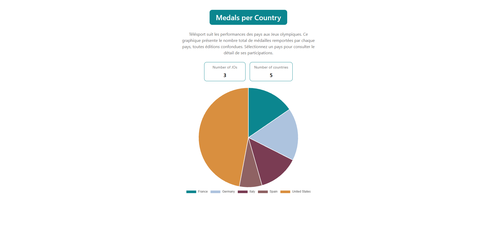
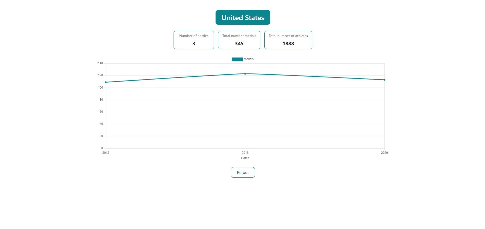
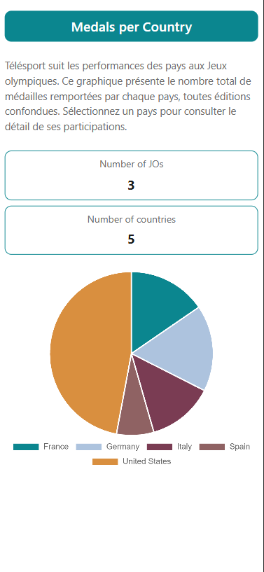

<p align="center"> 
     
</p> 

<h1 align="center">Télésport - Jeux Olympiques</h1> 

<p align="center"> 
    Application Angular de visualisation des performances des pays aux Jeux olympiques : un tableau de bord d'ensemble et une page de détail par pays. 
</p>

---

## Sommaire

- [Aperçu](#aperçu)
- [Prérequis techniques](#prérequis-techniques)
- [Installation](#installation)
- [Lancer l'application](#lancer-lapplication)
- [Scripts disponibles](#scripts-disponibles)
- [Fonctionnalités](#fonctionnalités)
- [Structure du projet](#structure-du-projet)
- [Architecture en bref](#architecture-en-bref)
- [Données](#données)
- [Décisions techniques](#décisions-techniques)
- [Documentation complémentaire](#documentation-complémentaire)

---

## Aperçu

### Tableau de bord

Nombre total de médailles par pays, toutes éditions confondues. Un clic sur une part ouvre la page du pays.



### Page détail

Indicateurs du pays et évolution de ses médailles édition par édition.



### Mobile et gestion des erreurs

<p>
  
  &nbsp;&nbsp;
  
</p>

---

## Prérequis techniques

| Outil | Version | Vérifier |
|---|---|---|
| **Node.js** | `^18.19.1`, `^20.11.1` ou `>=22` : exigence d'Angular 18 | `node --version` |
| **npm** | 9+ | `npm --version` |
| **Angular CLI** | 18.2.x : *facultatif* | `npx ng version` |

L'installation globale du CLI n'est pas nécessaire : toutes les commandes
ci-dessous passent par `npm`, qui utilise la version locale du projet.
Un navigateur **Chrome** ou **Chromium** est nécessaire pour exécuter les tests.

---

## Installation

```bash
git clone https://github.com/Kyorisan/OlympicGamesStarter.git
cd OlympicGamesStarter
npm install
```

---

## Lancer l'application

```bash
npm start
```

L'application est disponible sur **http://localhost:4200/**. Le rechargement
à chaud est actif : toute modification d'un fichier source recharge la page.

---

## Scripts disponibles

| Commande | Effet |
|---|---|
| `npm start` | Serveur de développement sur le port 4200 |
| `npm run build` | Build de production dans `dist/olympic-games-starter/` |
| `npm test` | Suite de tests unitaires (Karma + Jasmine) |

Sur une machine sans interface graphique (CI, conteneur) :

```bash
npm test -- --watch=false --browsers=ChromeHeadlessNoSandbox
```

---

## Fonctionnalités

**Tableau de bord** — route `/`

- Présentation de l'application
- Nombre de pays participants et nombre d'éditions des Jeux
- Graphique circulaire des totaux de médailles par pays
- Clic sur une part -> page de détail du pays
- Alternative accessible au clavier, équivalente au graphique

**Page détail** — route `/country/:id`

- Nom du pays, nombre de participations, total de médailles, total d'athlètes
- Courbe d'évolution des médailles édition par édition
- Retour au tableau de bord

**Gestion des erreurs**

| Situation | Comportement |
|---|---|
| URL inconnue | Page 404 avec lien de retour |
| Identifiant de pays inexistant ou non numérique | « Ce pays n'existe pas. » + retour |
| Pays sans aucune participation | Message explicite nommant le pays |
| Données indisponibles | Message clair + bouton « Réessayer » |
| Chargement en cours | Squelettes gris |

**Responsive** pour trois paliers : desktop ≥ 1200 px, tablette 768–1199 px,
mobile ≤ 767 px. Testé de 390 px à 1440 px.

**Accessibilité** pour la hiérarchie de titres valide, focus visibles, descriptions
textuelles des graphiques, et navigation au clavier vers chaque page pays.

---

## Structure du projet

```
src/
├── app/
│   ├── components/ (Composants présentationnels, réutilisables)
│   │   ├── header/ (Titre, texte de présentation, indicateurs)
│   │   ├── pie-chart/ (Graphique circulaire cliquable)
│   │   ├── line-chart/ (Graphique d'évolution)
│   │   └── state-panel/ (Chargement / vide / erreur)
│   │
│   ├── models/ (Interfaces TypeScript)
│   │   ├── olympic.model.ts
│   │   ├── participation.model.ts
│   │   ├── indicator.model.ts
│   │   ├── country-medals.model.ts
│   │   └── view-state.model.ts
│   │
│   ├── pages/ (Composants routés)
│   │   ├── dashboard/
│   │   ├── country-detail/
│   │   └── not-found/
│   │
│   ├── services/
│   │   └── data.service.ts (Le seul accès aux données)
│   │
│   ├── app.module.ts
│   └── app-routing.module.ts
│
├── assets/mock/olympic.json (Données simulées)
├── environments/ (apiUrl par environnement)
├── styles/ (variables et points de rupture SCSS)
└── styles.scss (styles globaux)
```

---

## Architecture en bref

> **Une seule porte d'entrée pour les données, et des composants qui ignorent
> d'où elles viennent.**

| Dossier | Injecte un service | Connaît le routeur | Reçoit ses données par |
|---|---|---|---|
| `pages/` | oui | oui | injection du `DataService` |
| `components/` | non | non | `@Input()` uniquement |

`DataService` est fourni en singleton (`providedIn: 'root'`) et constitue le
**seul** point de l'application à injecter `HttpClient`. Il charge les données
une fois, les diffuse par un `BehaviorSubject`, calcule les agrégats et traduit
les échecs réseau en état exploitable par l'interface.

Les pages exposent un unique flux `vm$` consommé par le pipe `async` : aucun
abonnement manuel, donc aucun désabonnement à gérer.

Le détail complet est dans **[ARCHITECTURE.md](ARCHITECTURE.md)**.

---

## Données

Les données proviennent de `src/assets/mock/olympic.json` : 5 pays, 3 éditions
(2012 Londres, 2016 Rio, 2020 Tokyo).

L'URL est définie dans `src/environments/environment.ts`. Pour brancher une API
REST, c'est **le seul fichier à modifier** — aucun composant ni aucune page n'a
connaissance de la provenance des données.

```ts
export const environment = {
  production: false,
  apiUrl: './assets/mock/olympic.json',
};
```

---

## Décisions techniques

**Pas de `any`** : Le contrat de données est décrit par des interfaces dans
`models/`, ce qui fait apparaître à la compilation toute divergence avec la
source.

**Identifiant plutôt que nom dans l'URL** : `/country/3` reste stable si un
libellé change, et évite l'encodage de `/country/United%20States`.

**Tri alphabétique** : Déterministe et indépendant de l'ordre de la source, donc
cohérent entre le tableau de bord et la page détail.

**`medalsCount` fait foi** : Les spécifications mentionnent une règle
`Totals = gold + silver + bronze` inapplicable ici : le jeu de données ne
contient que le total, jamais le détail par métal.

**Les indicateurs reflètent les données, pas la maquette** : La maquette affiche
10 pays et 10 éditions, le jeu de données en contient 5 et 3.

**Cycle de vie des graphiques encapsulé** : Chaque graphique obtient son canvas
par `@ViewChild` et détruit son instance Chart.js dans `ngOnDestroy`, ce qui
évite d'accumuler des écouteurs à chaque navigation.

---

## Documentation complémentaire

| Fichier | Contenu |
|---|---|
| [ARCHITECTURE.md](ARCHITECTURE.md) | Architecture détaillée : rôle de chaque bloc, API du service, contrats des composants, flux de données, préparation à une API |
| [notes-architecture.md](notes-architecture.md) | Journal de conception : audit du code initial, arbitrages, écarts assumés |